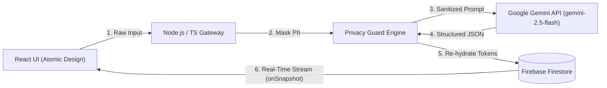

# OSCAR — Orchestrated Secure Confidential Agent Runtime

> **An enterprise-grade, spec-driven personal assistant and multi-agent runtime featuring local PII masking, Zero Data Retention orchestration, and real-time reactive synchronization.**

[](https://www.typescriptlang.org/)
[](https://opensource.org/licenses/MIT)
[](docs/spec/architecture.md)
[](docs/spec/privacy-guard-spec.md)
[](docs/spec/multi-agent-system.md)

---

## 🌟 Core Highlights & Architectural Principles

* 🛡️ **Confidentiality by Design (Local PII Masking):** Automatically strips personally identifiable information (emails, names, monetary amounts, phone numbers, IBANs, API keys) locally before dispatching prompts to external LLMs.
* 🤖 **Zero Data Retention Orchestration:** Built with the official Google GenAI SDK (`@google/genai`), enforcing strict JSON Schema runtime verification (`responseSchema`) with Google Gemini.
* 📐 **Spec-Driven Development (SDD):** System specifications, runtime contracts, and verification criteria are authoritatively defined in `docs/spec/` before production code is committed.
* ⚡ **Real-Time Cross-Device Sync:** Built on Firebase Firestore (Spark Free Tier) leveraging direct `onSnapshot` listeners to push updates instantaneously to connected desktop and mobile clients.
* 🧪 **Deterministic Engineering Rigor:** Core domain logic (Privacy Guard tokenization & re-hydration) guarantees $\ge 95\%$ unit test coverage with Vitest, running with 100% in-memory isolation.
* 🎨 **Client-Side Atomic Design:** React + TypeScript UI decoupled into isolated `atoms/`, `molecules/`, `organisms/`, and `views/` with scoped styling.
* 👥 **Multi-Agent Governance (PoLP & HITL):** Structured agentic workforce enforcing the Principle of Least Privilege and Human-in-the-Loop oversight across all engineering tasks.

---

## 🏗️ Architecture at a Glance



For full system diagrams, sequence workflows, and failure recovery protocols, see [**System Architecture Specification**](docs/spec/architecture.md).

---

## 📂 Project Structure

```
oscar/
├── docs/
│   └── spec/                          # Authoritative Specifications (Single Source of Truth)
│       ├── architecture.md            # System tiers, sequence flows, and Zero Trust model
│       ├── contracts.md               # Authoritative Zod runtime schemas & JSON Schemas
│       ├── privacy-guard-spec.md      # PII detection rules, RTL substitution & re-hydration
│       └── multi-agent-system.md      # Agent workforce, PoLP privileges & HITL workflows
├── client/                            # React + TypeScript + Vite (Atomic Design)
│   └── src/
│       ├── components/
│       │   ├── atoms/                 # Single-purpose isolated UI components (scoped CSS)
│       │   ├── molecules/             # Grouped atom components
│       │   └── organisms/             # Business domain widgets
│       ├── views/                     # Page-level screens (Dashboard, TaskBoard)
│       └── services/                  # Gateway client & Firestore listeners
├── server/                            # Node.js + TypeScript Gateway
│   ├── src/
│   │   ├── privacy/                   # Pure Privacy Guard Engine (Masker / Re-hydrator)
│   │   ├── agent/                     # Gemini Orchestrator (Google GenAI SDK)
│   │   └── routes/                    # API endpoints
│   └── tests/                         # Unit & integration test suites (Vitest, >=95% target)
├── .gitignore                         # Comprehensive ignore rules
├── LICENSE                            # MIT License
└── README.md                          # Project documentation portal
```

---

## 📋 Authoritative System Specifications

The OSCAR codebase strictly adheres to the following specification documents:

1. [**System Architecture**](docs/spec/architecture.md): Component breakdown, end-to-end data sequence diagrams, tier specifications, and Zero Trust guarantees.
2. [**Domain & Data Contracts**](docs/spec/contracts.md): Authoritative Zod schemas for PII token maps, sanitization results, Gemini structured task responses, Firestore entities, and privacy audit logs.
3. [**Privacy Guard Engine Specification**](docs/spec/privacy-guard-spec.md): Regex patterns for 6 PII categories, Right-to-Left replacement algorithm, recursive JSON re-hydration logic, and Vitest test criteria.
4. [**Multi-Agent System & Governance**](docs/spec/multi-agent-system.md): Agent topology (Lead Architect, Master Orchestrator, Docs Worker, Privacy Specialist, QA Worker), Principle of Least Privilege (PoLP) matrix, and Human-in-the-Loop (HITL) checkpoints.

---

## 🛡️ Privacy Guard: How It Works

1. **Detection:** Scans input for API keys, IBANs, email addresses, phone numbers, monetary values, and person names using prioritized regex matchers.
2. **Right-to-Left Masking:** Substitutes detected entities from end to start of the string, preserving character indices and preventing offset drift.
3. **Structured Inference:** Sends sanitized text (`[PERSON_1]`, `[AMOUNT_MONEY_1]`) to Google Gemini alongside strict `responseSchema`.
4. **Recursive Re-hydration:** Walks the returned JSON tree depth-first and restores cleartext values from an ephemeral in-memory dictionary.
5. **Zero Trace:** The mapping dictionary is immediately garbage collected. The audit log records only non-PII compliance metrics.

---

## 🚀 Getting Started

*(Environment setup and dependency installation instructions will be provided in the implementation phase under HITL supervision).*

---

## 📄 License
This project is licensed under the [MIT License](LICENSE).
