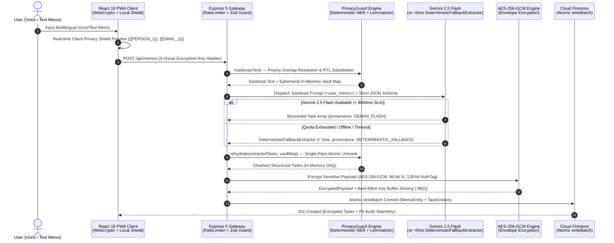

# OSCAR — Orchestrated Secure Confidential Agent Runtime

> **An enterprise-grade, spec-driven confidential personal assistant and multi-agent runtime featuring a Dual-Shield Privacy Enclave, Multilingual Deterministic NER PII Masking, Zero Data Retention AI Orchestration, AES-256-GCM Encryption at Rest (Per-Request Session Key over TLS), and an Installable PWA with In-Memory Deterministic Offline Fallback.**

[](package.json)
[](docs/spec/architecture.md)
[-brightgreen.svg)](#comprehensive-quality-metrics)
[](#comprehensive-quality-metrics)
[](docs/spec/multi-agent-system.md)
[](client/public/manifest.webmanifest)
[](https://github.com/lukasmatusiewicz/OSCAR/actions/workflows/ci.yml)
[](https://www.typescriptlang.org/)
[](LICENSE)

---

## 🌟 Executive Summary & Architecture Highlights

OSCAR (**Orchestrated Secure Confidential Agent Runtime**) bridges the gap between high-reasoning cloud Foundation Models and strict enterprise/personal data sovereignty. Instead of transmitting raw user thoughts, voice transcripts, or executive memos containing sensitive PII to third-party LLM endpoints, OSCAR enforces a **Zero-Trust Confidential Intake Pipeline** that strips, vaults, and rehydrates sensitive entities locally while persisting only authenticated ciphertext at rest.

### 1. 🛡️ Dual-Shield Privacy Enclave
* **Client & Edge Cryptographic Vaulting:** AES-256-GCM encrypted at rest; per-request session key supplied over TLS (single-user local/demo architecture; multi-tenant auth is on the v2.0 roadmap). The client generates an ephemeral in-memory 256-bit random session key (`crypto.getRandomValues`) with random 96-bit IVs and 128-bit authentication tags — tasks encrypted in a prior session cannot be decrypted after a page reload (`F5`) until passphrase-derived keys / auth are added in v2.0. Server-side memory zeroing (`Buffer.fill(0)`) is applied as best-effort defense-in-depth on key buffers (subject to JS runtime/GC semantics).
* **Multilingual Deterministic NER `PrivacyGuard`:** Deterministic algorithmic + regex NER engine combining regex scanners (`SECRET_KEY`, `IBAN`, `EMAIL`, `PHONE`, `AMOUNT_MONEY`, `NATIONAL_ID`, `ADDRESS`, `HEALTH_DATA`) with multilingual (PL/DE/EN) morphological lemmatization (`LinguisticNormalizer`), temporal boundary protection (`TemporalResolver`), deterministic token vaulting (`{{PERSON_1}}` / `[PERSON_1]`, `{{PHONE_1}}` / `[PHONE_1]`, `{{EMAIL_1}}` / `[EMAIL_1]`), and an optional Tier-2 ML extension point (`maskAsync`, currently unused in production routes).

### 2. 🤖 Gemini 2.5 Flash Orchestrator Gateway & Dual-Layer Schema Assurance
* **Zero Data Retention Cloud Inference:** Built on the official Google GenAI SDK (`@google/genai`) targeting `gemini-2.5-flash` with strict OpenAPI/JSON Schema generation (`responseSchema`) and `<user_memo>` XML prompt-injection sandboxing.
* **Runtime Zod Boundary Validation & Deterministic Failover:** Every LLM output and API payload is verified through authoritative Zod contracts. `DeterministicFallbackExtractor` executes in `< 5ms` when triggered; end-to-end failover on upstream network degradation, rate limiting (global 12-RPM token-bucket rate limiter on Gemini API calls), or timeout is bounded by the strict `8,000ms` `AbortSignal.timeout(8000)` SLA with zero data loss.

### 3. 🗄️ Queryable Metadata Separation & Google Cloud Firestore Persistence
* **Encrypted-at-Rest Ciphertext Storage:** AES-256-GCM encrypted at rest; per-request session key supplied over TLS (single-user local/demo architecture; multi-tenant auth is on the v2.0 roadmap). Sensitive task fields (`title`, `summary`, `subtasks`) and raw memo contents are stored strictly as `AES-256-GCM` encrypted blobs (`EncryptedPayload`), while sanitized operational metadata (`category`, `priority`, `status`, `scheduledDate`, `provenance`, `tags`, `location`, `contactPerson`, `amount`, `scheduledTime`, and `sanitizedContentPreview` on `MemoEntity`) remains queryable for high-speed indexing.
* **Atomic `writeBatch` Mutations & Full CRUD Lifecycle:** Uses Firestore atomic batch commits (`writeBatch`) with automatic in-memory repository fallback (`TaskStore`) for zero-config local development. Supports the complete Human-in-the-Loop (HITL) task lifecycle: **Draft $\rightarrow$ Confirm $\rightarrow$ Inline Edit $\rightarrow$ Complete $\rightarrow$ Delete**.

### 4. 📊 Pillar 8 Structured Telemetry
* **Zero-PII Multi-Level Observability:** Structured JSON and console telemetry across both client and server (`debug`, `info`, `warn`, `error`) featuring correlation IDs, latency instrumentation, and compile-time/runtime guarantees that raw PII or cryptographic material is never written to stdout or log sinks.

### 5. 📱 Responsive UI & Native PWA
* **Mobile-First Atomic Design & Installable PWA:** Engineered down to `360px` viewports with a responsive CSS grid, glassmorphic dark UI, installable PWA manifest (`manifest.webmanifest`) + in-memory deterministic offline fallback (no Service Worker asset caching yet), native PWA install prompt (`InstallPrompt`), and 1-click **RFC 5545-style `.ics` iCalendar export** (without 75-octet line folding) for scheduled tasks.

---

## 🔄 Visual Confidential Intake Lifecycle

### End-to-End Sequence & Data Flow (Mermaid)



### Architectural Pipeline Overview (ASCII)

```text
+---------------------------------------------------------------------------------------------------+
|                        OSCAR ZERO-PII CONFIDENTIAL INTAKE ENCLAVE (v1.0.0)                        |
+---------------------------------------------------------------------------------------------------+

  [1. Voice / Text Memo]
         │  "Meeting with John Doe (john@company.com, +49 600100200) tomorrow at 14:00. Note: 25 000 EUR"
         ▼
  [2. Local PrivacyGuard NER Masking & Morphological Lemmatization (PL / DE / EN)]
         │  ├── Priority Overlap Resolution: SECRET_KEY > IBAN > EMAIL > PHONE > AMOUNT > PERSON
         │  ├── Temporal Boundary Guard: Protects dates/times ("tomorrow at 14:00") from false NER capture
         │  └── Ephemeral Token Vault: [PERSON_1], [EMAIL_1], [PHONE_1], [AMOUNT_MONEY_1]
         ▼
  [3. Sanitized Cloud Prompt (<user_memo> XML Sandbox)]
         │  "Meeting with [PERSON_1] ([EMAIL_1], [PHONE_1]) tomorrow at 14:00. Note: [AMOUNT_MONEY_1]"
         ▼
  [4. Gemini 2.5 Flash Orchestrator  ───(8000ms timeout / error ─► <5ms Extractor)───►  DeterministicFallbackExtractor]
         │  ├── Strict JSON Schema (responseSchema) + Runtime Zod Contract Validation
         │  └── Multi-Intent Task Decomposition + EU AI Act Art. 13 Provenance Fields
         ▼
  [5. Local PII Rehydration & AES-256-GCM Envelope Encryption]
         │  ├── Depth-First Single-Pass Atomic Regex Unmasking
         │  ├── WebCrypto / Node Crypto AES-256-GCM (256-bit ephemeral session key, 12-byte IV, 16-byte AuthTag)
         │  └── Ephemeral Vault Garbage-Collected & Best-Effort Key Buffer Zeroing (.fill(0))
         ▼
  [6. Google Cloud Firestore Atomic Batch Commit]
         ├── Ciphertext Blob: { ciphertext, iv, authTag, keyId } (Zero Cleartext at Rest)
         └── Queryable Metadata: { category, priority, status: "DRAFT", provenance, scheduledDate, location, contactPerson, amount, scheduledTime }
```

---

## 🧪 Comprehensive Quality Metrics

OSCAR v1.0.0 is verified by **562 automated tests passing across 43 test suites (100% pass rate)** with strict coverage thresholds (`>= 95%` on server with 95.75% branch coverage; `>= 90%` threshold on client with 91.23% branch and 97.87% lines/statements), zero ESLint warnings/errors, and strict TypeScript compilation (`noImplicitAny`, `strictNullChecks`).

| Verification Tier | Workspace | Test Suites | Passing Tests | Coverage Gate / Measured | Key Assurance Domains |
| :--- | :--- | :---: | :---: | :---: | :--- |
| **Backend Unit & Crypto** | `server` | 11 | 247 | `>= 95%` Gate | Deterministic NER `PrivacyGuard`, `LinguisticNormalizer` (PL/DE/EN), `TemporalResolver`, `EncryptionService` (AES-256-GCM & best-effort memory zeroing), `GeminiOrchestrator`, `DeterministicFallbackExtractor`, `RateLimiter`, `FirestoreTaskStore`, Structured `Logger` |
| **Backend API & Integration** | `server` | 4 | 54 | `>= 95%` Gate | `/api/memos`, `/api/tasks`, `/api/health`, `/api/docs` (OpenAPI 3.1 + Scalar UI), CORS, Zod error boundaries |
| **Adversarial & E2E Full-Stack** | `server` | 3 | 43 | `>= 95%` Gate | Multilingual chaotic inputs, prompt-injection resistance, GDPR Art. 9 taxonomy, Draft-to-Confirm HITL editing, full confidential roundtrip |
| **Frontend Atomic UI & Hooks** | `client` | 24 | 207 | `>= 90%` Gate | Atomic Design hierarchy (`atoms`, `molecules`, `organisms`, `views`), `ClientCryptoService` (WebCrypto ephemeral 256-bit session key + AES-GCM), `GatewayClient`, RFC 5545-style `.ics` Calendar Export, PWA `InstallPrompt` |
| **Frontend Security Audit** | `client` | 1 | 11 | `>= 90%` Gate | `zeroPiiLeakage.test.tsx` — verifies zero raw PII or session keys leak into DOM attributes, `localStorage`, or console sinks |
| **Static Analysis & Types** | `root` | — | **0 Errors / 0 Warnings** | **Strict TS** | ESLint (`@typescript-eslint`) + TypeScript 5.7 (`tsc --noEmit` & `vite build`) |
| **TOTAL VERIFIED** | **All** | **43 Suites** | **562 / 562 (100%)** | **Server >= 95% (95.75% br.) \| Client >= 90% (91.23% br., 97.87% lines)** | **Production Release Gate (`v1.0.0`)** |

---

## 📂 Project Structure

```text
oscar/
├── docs/
│   └── spec/                          # Authoritative Specifications (Single Source of Truth)
│       ├── architecture.md            # System tiers, sequence flows, encryption, rate limits & Zero Trust
│       ├── contracts.md               # Authoritative Zod runtime schemas & JSON Schemas
│       ├── multi-agent-system.md      # Maker-Checker-Critic topology, PoLP matrix & 8 Engineering Pillars
│       ├── openapi.yaml               # OpenAPI 3.1.0 Gateway specification (v1.0.0)
│       └── privacy-guard-spec.md      # PII detection rules, RTL substitution & atomic re-hydration
├── client/                            # React 18 + TypeScript + Vite PWA (25 suites, 218 tests)
│   ├── public/
│   │   ├── manifest.webmanifest       # Native PWA Web App Manifest & icons
│   │   └── icon-192.svg / icon-512.svg
│   ├── src/
│   │   ├── components/
│   │   │   ├── atoms/                 # Badge, Button, Input, InstallPrompt, PrivacyShieldBadge
│   │   │   ├── molecules/             # CategoryBadge, PrioritySelector, SearchBox, TokenPreviewBadge
│   │   │   └── organisms/             # MemoEditor, PrivacyAuditPanel, TaskCard, TaskList
│   │   ├── hooks/                     # useTasks, useMemos, usePrivacyShield
│   │   ├── services/                  # ClientCryptoService (WebCrypto), GatewayClient
│   │   ├── utils/                     # calendarExport (.ics), linguisticNormalizer, temporalResolver, logger
│   │   └── views/                     # Dashboard, TaskBoard
│   └── tests/                         # Vitest + React Testing Library + Zero-PII DOM Security Suite
├── server/                            # Node.js + Express 5 + TypeScript Gateway (18 suites, 344 tests)
│   ├── src/
│   │   ├── agent/                     # GeminiOrchestrator (@google/genai), DeterministicFallbackExtractor, TemporalResolver
│   │   ├── gateway/                   # Token-bucket RateLimiter (12 RPM)
│   │   ├── middleware/                # Defensive errorHandler (zero stack-trace / PII leakage)
│   │   ├── privacy/                   # PrivacyGuard (Deterministic Algorithmic + Regex NER), LinguisticNormalizer
│   │   ├── routes/                    # memos, tasks, health, docs (OpenAPI / Scalar viewer)
│   │   ├── security/                  # EncryptionService (AES-256-GCM), requestKey derivation
│   │   ├── store/                     # ITaskRepository, FirestoreTaskStore (writeBatch), TaskStore (In-Memory)
│   │   └── utils/                     # Pillar 8 structured logger
│   └── tests/                         # Unit, Route Integration, Chaotic Multilingual & E2E Test Suites
├── .env.example                       # Sanitized environment configuration template
├── firebase.json                      # Firebase Hosting & SPA rewrite configuration
├── package.json                       # Workspace root orchestrator (v1.0.0)
└── README.md                          # Executive showcase & operations portal
```

---

## 🚀 Quickstart & Operations Guide

### Prerequisites
* **Node.js:** `>= 20.6.0` LTS (required by `tsx --env-file`; v20.6+, v22, or v24 recommended)
* **npm:** `>= 10.0.0`
* **Google Gemini API Key *(Optional)*:** Obtainable from [Google AI Studio](https://aistudio.google.com/app/apikey). If omitted, OSCAR automatically operates using the built-in `< 5ms` `DeterministicFallbackExtractor` rule engine.
* **Google Cloud Firestore *(Optional)*:** If `FIREBASE_PROJECT_ID` / credentials are omitted, the server automatically falls back to the zero-configuration in-memory `TaskStore`.

### 1. Installation & Environment Setup

```bash
# Clone the repository and enter the workspace
git clone https://github.com/lukasmatusiewicz/OSCAR.git
cd OSCAR/oscar

# Install dependencies across root, server, and client
npm install
npm --prefix server install
npm --prefix client install

# Copy the sanitized environment template
cp .env.example server/.env
```

Edit `server/.env` as needed (all fields have safe local defaults):

```env
GEMINI_API_KEY=your_gemini_api_key_here
PORT=3000
NODE_ENV=development
CORS_ORIGIN=http://localhost:5173
LOG_LEVEL=info
VITE_LOG_LEVEL=info
```

> [!IMPORTANT]
> **Security Invariant:** `.gitignore` strictly blocks all `.env*` files (except `.env.example`), `*credentials*.json`, `*service-account*.json`, and `*firebase-adminsdk*.json`. Never commit live API keys or service account keys to version control.

### 2. 1-Click Full-Stack Startup

Launch both the Express 5 Confidential Gateway (`http://localhost:3000`) and the React 18 Vite PWA (`http://localhost:5173`) concurrently with color-coded streaming logs:

```bash
npm run dev
```

* **Frontend Application:** `http://localhost:5173`
* **Interactive OpenAPI 3.1 Docs (Scalar UI):** `http://localhost:3000/api/docs`
* **Raw OpenAPI 3.1 YAML Specification:** `http://localhost:3000/api/docs/openapi.yaml`
* **Gateway Health Probe:** `http://localhost:3000/api/health`

### 3. Running Tests, Linting & Production Builds

```bash
# Run all 562 automated tests across server (344) and client (218)
npm test

# Run server or client test suites individually
npm --prefix server test
npm --prefix client test

# Run full test coverage reports (V8 coverage provider)
npm run test:coverage

# Run full-stack End-to-End (E2E) confidential lifecycle suites
npm run test:e2e

# Verify zero ESLint errors/warnings across both workspaces
npm run lint

# Compile TypeScript and build production bundles
npm run build
```

### 4. Native PWA Installation Instructions

OSCAR includes a standards-compliant Web App Manifest ([`manifest.webmanifest`](client/public/manifest.webmanifest)) and an intelligent in-app installation banner ([`InstallPrompt.tsx`](client/src/components/atoms/InstallPrompt.tsx)):

* **Desktop (Chrome / Edge / Brave):** Open `http://localhost:5173` (or the deployed HTTPS URL). Click the **"Install App"** button in the OSCAR top bar or the browser address bar install icon to launch OSCAR in a standalone native window.
* **iOS (Safari) & Android (Chrome):** Tap the browser **Share** menu (iOS) or **More Options** menu (Android) and select **"Add to Home Screen"**. OSCAR launches in `standalone` display mode without browser chrome.

---

## 📚 Specification & Documentation Index

OSCAR follows **Spec-Driven Development (SDD)**—all architectural boundaries, threat models, and data contracts are formally specified in `docs/spec/`:

* 🏛️ [**System Architecture Specification (`docs/spec/architecture.md`)**](docs/spec/architecture.md) — Tier architecture, end-to-end confidential sequences, AES-256-GCM envelope encryption, 12 RPM rate limiting, and fallback resilience.
* 🔒 [**Privacy Guard Specification (`docs/spec/privacy-guard-spec.md`)**](docs/spec/privacy-guard-spec.md) — Deterministic algorithmic & regex NER PII detection, priority overlap resolution, Right-to-Left span substitution, atomic single-pass rehydration, and zero-leakage guarantees.
* 📜 [**OpenAPI 3.1 Gateway Contract (`docs/spec/openapi.yaml`)**](docs/spec/openapi.yaml) — Authoritative REST API specification for `/api/memos`, `/api/tasks`, `/api/health`, and `/api/docs` (`v1.0.0`).
* 🧬 [**Domain & Data Schema Contracts (`docs/spec/contracts.md`)**](docs/spec/contracts.md) — Authoritative Zod schemas, `EncryptedPayload`, `TaskEntity`, `MemoEntity`, and GDPR/EU AI Act provenance models.
* 🤖 [**Multi-Agent System & 8 Pillars of Craftsmanship (`docs/spec/multi-agent-system.md`)**](docs/spec/multi-agent-system.md) — Maker-Checker-Critic governance topology, Principle of Least Privilege (PoLP) matrix, Human-in-the-Loop (HITL) checkpoints, and Pillar 8 Structured Telemetry standards.

---

## 📄 License

This project is licensed under the [MIT License](LICENSE).
