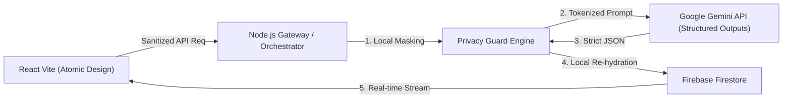

# OSCAR — Orchestrated Secure Confidential Agent Runtime

> **An enterprise-grade, spec-driven personal agent framework featuring local PII masking, Zero Data Retention orchestration, and real-time synchronization.**

[](https://www.typescriptlang.org/)
[](https://opensource.org/licenses/MIT)
[](docs/spec/architecture.md)
[]()

---

## 🌟 Key Features

* 🛡️ **Confidentiality by Design (Local PII Masking):** Automatically strips personally identifiable information (emails, names, monetary amounts, phone numbers, API keys) locally before dispatching prompts to external LLMs.
* 🤖 **Zero Data Retention Orchestration:** Built around the official Google GenAI SDK with strictly enforced `responseSchema` (Zod-driven Structured Outputs).
* 📐 **Spec-Driven Development (SDD):** System specifications, data contracts, and verification plans exist in `docs/spec/` before any line of production code is written.
* ⚡ **Real-Time Cross-Device Sync:** Firebase Firestore layer propagates task state changes instantly between desktop and mobile clients.
* 🧪 **Deterministic Test Rigor:** Core domain logic (Privacy Guard tokenization & re-hydration) guarantees $\ge 90\%$ unit test coverage with Vitest.
* 🎨 **Atomic Design UI:** React + TypeScript client structured cleanly into strict `atoms/`, `molecules/`, and `organisms/`.

---

## 🏗️ Architecture at a Glance



Detailed architectural blueprints and sequence diagrams are documented in [`docs/spec/architecture.md`](docs/spec/architecture.md).

---

## 📂 Project Structure

```
oscar/
├── docs/
│   └── spec/                      # Authoritative specifications (Single Source of Truth)
│       ├── architecture.md        # System components, data flows, and security model
│       ├── contracts.md           # Zod runtime schemas & JSON Schema definitions
│       └── privacy-guard-spec.md  # PII detection rules & tokenization lifecycle
├── client/                        # React + TypeScript + Vite (Atomic Design)
│   └── src/
│       ├── components/
│       │   ├── atoms/             # Single-purpose isolated UI elements
│       │   ├── molecules/         # Grouped atom components
│       │   └── organisms/         # Business domain widgets
│       └── services/              # API Client & Firestore Real-time subscriptions
├── server/                        # Node.js + TypeScript Gateway
│   ├── src/
│   │   ├── privacy/               # Pure Privacy Guard Engine (PII Masker / Unmasker)
│   │   ├── agent/                 # Gemini Orchestrator (Google GenAI SDK)
│   │   └── routes/                # REST & Streaming endpoints
│   └── tests/                     # Unit test suite (Vitest, >=90% target coverage)
├── .gitignore
├── LICENSE
└── README.md
```

---

## 📋 Specifications & Contracts

1. [**System Architecture**](docs/spec/architecture.md): Overview, component breakdown, and security guarantees.
2. [**Domain Contracts**](docs/spec/contracts.md): Authoritative Zod schemas for Memos, Tasks, Privacy Tokens, and Audit Logs.
3. [**Privacy Guard Specification**](docs/spec/privacy-guard-spec.md): Regex patterns, right-to-left replacement algorithm, and re-hydration rules.

---

## 🚀 Getting Started

*(Setup instructions will be populated during the implementation phase).*

---

## 📄 License
This project is licensed under the [MIT License](LICENSE).
