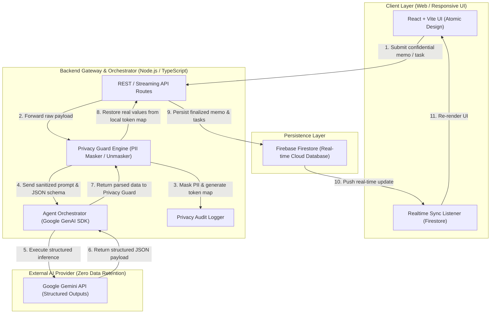
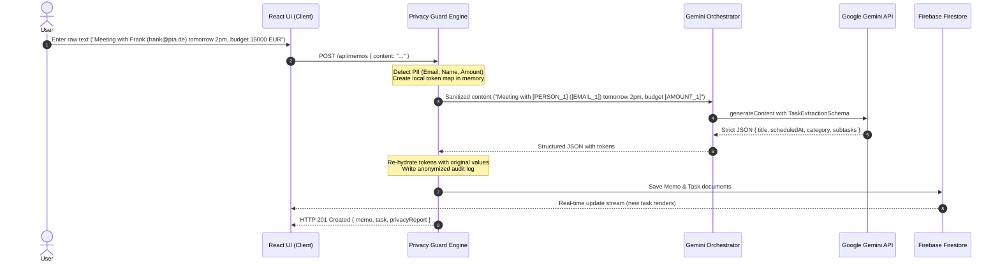

# OSCAR System Architecture Specification

## 1. Overview & Vision
**OSCAR** (**O**rchestrated **S**ecure **C**onfidential **A**gent **R**untime) is an enterprise-grade, privacy-first personal assistant and multi-agent task orchestrator. It bridges the power of generative AI models (Google Gemini) with strict data privacy constraints (Zero Data Retention principles, local PII masking, client-side data protection).

The core tenet of OSCAR is **Confidentiality by Design**: no sensitive user data (names, emails, credentials, financial details) ever leaves the local/private boundary in plain text.

---

## 2. High-Level Component Architecture

---

## 3. Layer Specifications

### 3.1 Client Layer
* **Framework:** React 18+ with TypeScript, bundled with Vite.
* **Architecture:** Atomic Design structure:
  * `atoms/`: Fundamental UI elements (Buttons, Badges, Inputs, Icons). Each in a dedicated folder with scoped CSS.
  * `molecules/`: Composite controls (SearchBox, PrivacyBadge, PrioritySelector).
  * `organisms/`: Self-contained functional widgets (MemoEditor, TaskList, PrivacyAuditPanel).
  * `views/`: Page-level screens (Dashboard, TaskBoard, Settings).
* **State Management:** Reactive local state + custom hooks for Firestore subscriptions, ensuring lightweight bundle size.

### 3.2 Backend Gateway & Orchestrator
* **Runtime:** Node.js (v20+) with TypeScript and strict compiler settings (`strict: true`).
* **Roles:**
  1. **Security Isolation:** Houses API keys (`GEMINI_API_KEY`) and Firebase Admin credentials. The client never touches third-party credentials.
  2. **Privacy Guard Engine:** Pure, deterministic TypeScript module responsible for pattern extraction, token substitution, and post-inference re-hydration.
  3. **Agent Orchestrator:** Uses official `@google/genai` SDK with strict `responseSchema` enforcing structured output.

### 3.3 Persistence Layer (Firebase Firestore)
* Cloud-hosted NoSQL document database used in Spark Plan (Free Tier).
* Real-time listeners (`onSnapshot`) push updates instantly across devices (desktop/mobile).

---

## 4. End-to-End Data Flow Sequence

---

## 5. Security & Zero Trust Guarantees
1. **Zero Secret Leakage:** No client-side exposure of LLM credentials or service accounts.
2. **Local Token Store:** The token mapping dictionary is ephemeral and stored in server memory only during the lifecycle of the request.
3. **Structured Schema Validation:** Every AI response is validated at runtime against Zod schemas before being accepted into the domain layer.
4. **Resilience & Fallback:** If the external LLM is unreachable, the system falls back to a deterministic local rule-based extractor (*Graceful Degradation*).
