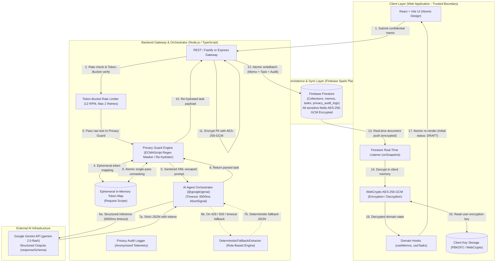
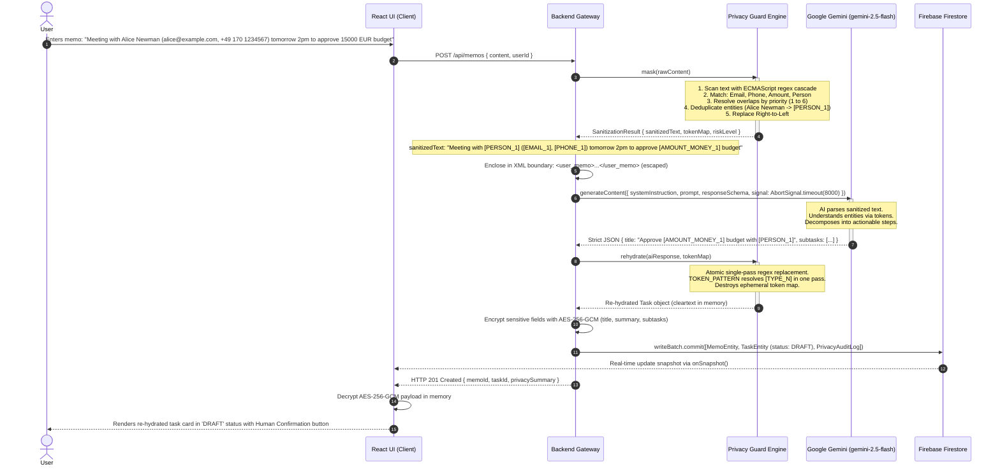
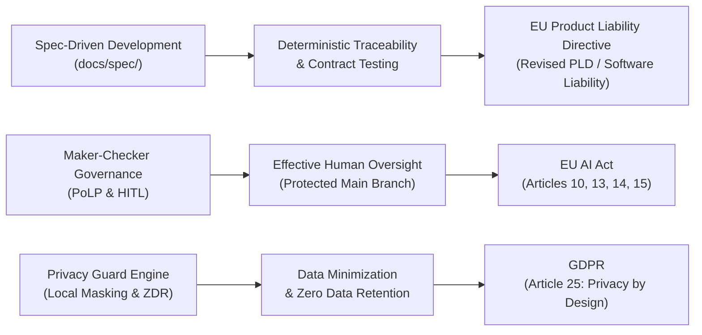

# OSCAR System Architecture Specification

## 1. Executive Summary & Vision
**OSCAR** (**O**rchestrated **S**ecure **C**onfidential **A**gent **R**untime) is an enterprise-grade, privacy-first personal assistant and task orchestration framework. It marries the analytical and generative capabilities of Google Gemini with rigorous data confidentiality guarantees based on Zero Data Retention (ZDR), local Personally Identifiable Information (PII) masking, and client-side AES-256-GCM envelope encryption at rest.

The foundational principle of OSCAR is **Confidentiality by Design**: no sensitive user data—such as personal names, email addresses, monetary amounts, phone numbers, international bank account numbers (IBANs), or confidential tokens/keys—ever leaves the private, trusted execution boundary in plaintext, and unencrypted cleartext PII is **never persisted** to public cloud storage.

---

## 2. High-Level System Architecture

OSCAR follows a multi-tiered, decoupled client-server architecture designed for high security, end-to-end type safety, and real-time synchronization.



---

## 3. Tiered Layer Specifications

### 3.1 Client Layer (Frontend & Cryptographic Boundary)
* **Core Technology:** React 18+ with TypeScript, bundled using Vite.
* **Architecture Pattern:** **Atomic Design** system strictly structured to eliminate duplicated components and preserve maintainability:
  * `atoms/`: Smallest indivisible UI elements (e.g., `Button`, `Badge`, `Input`, `Icon`, `Typography`). Each component resides in its own dedicated subfolder with isolated CSS/Module styling (`src/components/atoms/Button/Button.tsx`, `Button.css`).
  * `molecules/`: Assemblies of atoms functioning as cohesive UI units (e.g., `PrivacyIndicator`, `PriorityBadge`, `SearchBar`, `DateDisplay`).
  * `organisms/`: Self-contained functional widgets bound to domain behavior (e.g., `MemoInputForm`, `TaskList`, `TaskCard`, `PrivacyAuditTable`).
  * `views/`: Page-level route targets (e.g., `DashboardView`, `TaskBoardView`, `SettingsView`).
* **Client-Side Cryptographic Boundary (WebCrypto API):** All incoming task titles, summaries, and subtasks stored in Firestore `encryptedPayload` fields are decrypted locally in client memory using WebCrypto AES-256-GCM. Unencrypted PII is never stored in persistent browser databases (IndexedDB or LocalStorage).
* **Real-time Reactive Sync:** Client initializes direct Firestore subscriptions (`onSnapshot`) scoped to the active user context. When new tasks are created or status changes, UI reflects updates instantaneously without manual polling.
* **Security Posture:** Zero third-party API keys or service account credentials exist in the client bundle. All sensitive AI operations are routed through the backend gateway.

### 3.2 Backend Gateway & Orchestrator
* **Core Technology:** Node.js (v20+ LTS) running TypeScript with compiler configuration set to `strict: true`.
* **Primary Responsibilities:**
  1. **Confidentiality Guarding:** Intercepts every inbound prompt, extracts PII tokens using the Privacy Guard engine, and holds the replacement dictionary in request-scoped ephemeral memory.
  2. **AI Orchestration:** Communicates with the official `@google/genai` SDK using `generateContent` configured with native `systemInstruction` and `responseSchema` (structured outputs derived from Zod contracts).
  3. **Atomic Re-hydration & Sanitization:** Traverses the returned structured JSON hierarchy, substituting synthetic tokens with original values using atomic single-pass regex replacement.
  4. **AES-256-GCM Envelope Encryption at Rest:** Encrypts sensitive fields prior to persisting documents to Cloud Firestore.
  5. **Auditability:** Writes anonymized performance and detection metrics (number of tokens masked, types detected, latency in ms) into the audit collection without logging any raw user PII.
  6. **Quota Optimization & Atomic Batches:** Uses Firestore `writeBatch` to bundle memo, task, and audit log into a single commit (3 writes per memo).

### 3.3 External AI Provider Layer (Google Gemini)
* **Model Selection:** `gemini-2.5-flash` (or current GA Flash model) optimized for low latency, high throughput, and cost-effectiveness under the Google AI Studio Free Tier (15 RPM / 1500 RPD).
* **Structured Outputs:** Gemini `generationConfig.responseSchema` is populated with a strict JSON schema generated directly from domain Zod definitions. This eliminates hallucinated formatting, markdown fencing drift, or missing required fields.
* **Native System Instruction:** System directives are passed via the dedicated `systemInstruction` property, cleanly separating control instructions from untrusted user data.
* **Zero Data Retention (ZDR):** Gemini API under standard enterprise terms operates with Zero Data Retention principles, preventing user prompts from being used to train general foundational models.

### 3.4 Persistence Layer (Firebase Firestore)
* **Hosting Model:** Cloud Firestore under Spark Tier (Free Plan: 1 GiB storage, 50,000 document reads, 20,000 document writes per day).
* **Spark Quota Write Consolidation:** Every memo processing pipeline executes an atomic `writeBatch` consolidating:
  1. `memos/{memoId}`: Metadata + `encryptedPayload`
  2. `tasks/{taskId}`: Operational metadata + `encryptedPayload` (Status: `'DRAFT'`)
  3. `privacy_audit_logs/{auditId}`: Non-PII telemetry log
  This strict 3-write transaction guarantees that the 20,000 daily write quota comfortably supports over 6,600 processed memos per day.
* **Real-time Engine:** Bi-directional document streaming over WebSockets/gRPC pushes database mutations immediately to listening clients.

---

## 4. End-to-End Data Flow Sequence

The complete lifecycle of a user prompt—from raw input to masked AI analysis, unmasking, client-side/envelope encryption, database write, and real-time reactive rendering—is depicted below:



---

## 5. Security, Resilience & Zero Trust Guarantees

### 5.1 AES-256-GCM Envelope Encryption at Rest
To satisfy Zero Trust and GDPR Article 25 (Privacy by Design), no unencrypted cleartext user data or unmasked PII is ever written to Firestore:
1. **Cipher Suite:** Authenticated symmetric encryption using **AES-256-GCM** with a unique 96-bit (12-byte) Initialization Vector (IV) generated per document write and a 128-bit authentication tag.
2. **Payload Structure:** Sensitive fields are serialized to JSON, encrypted, and wrapped in `EncryptedPayloadSchema`:
   ```typescript
   {
     ciphertext: "<base64>",
     iv: "<base64>",
     authTag: "<base64>",
     keyId: "v1"
   }
   ```
3. **Queryable Metadata Separation:** Only non-PII operational fields (`id`, `memoId`, `userId`, `category`, `priority`, `status`, `scheduledDate`, `tags`, `provenance`, `modelVersion`, `createdAt`, `updatedAt`) remain unencrypted to permit efficient Firestore index queries and client-side filtering.

### 5.2 Rate Limiting, Timeouts & Graceful Degradation
To protect against upstream provider outages, quota exhaustion, and Denial of Service:
1. **Token-Bucket Rate Limiter:** The gateway enforces a strict **12 requests per minute (RPM)** cap per instance, safely remaining below the Google AI Studio Free Tier ceiling of 15 RPM. Requests exceeding the rate limit are held in an in-memory queue with jittered exponential backoff (initial delay: 1,000ms, multiplier: 2.0, max 2 retries).
2. **Strict Request Timeouts:** External calls to Gemini API are wrapped with `AbortSignal.timeout(8000)`. If Google Gemini fails to respond within 8,000ms, the request is aborted immediately and fails over to local processing.
3. **Deterministic Fallback Extractor (`DeterministicFallbackExtractor`):** If Gemini is unreachable, times out, or returns HTTP 429/503, the orchestrator triggers the local deterministic rule engine without dropping the user memo:

```typescript
export class DeterministicFallbackExtractor {
  /**
   * Deterministically parses a sanitized or raw memo into ExtractedTask without AI inference.
   */
  public static extract(memoText: string): ExtractedTask {
    const lines = memoText.split(/\r?\n/).map(l => l.trim()).filter(Boolean);
    const firstLine = lines[0] ?? 'New Memo Action Item';

    // Title: First line truncated between 3 and 120 chars
    const title = firstLine.length > 120 ? `${firstLine.substring(0, 117)}...` : firstLine.padEnd(3, '.');

    // Priority Inference via Keyword Lexicon
    const lower = memoText.toLowerCase();
    let priority: TaskPriority = 'MEDIUM';
    if (/\b(?:urgent|asap|emergency|critical|immediately)\b/.test(lower)) {
      priority = 'URGENT';
    } else if (/\b(?:high|important|deadline|today|tomorrow)\b/.test(lower)) {
      priority = 'HIGH';
    } else if (/\b(?:low|someday|optional|minor)\b/.test(lower)) {
      priority = 'LOW';
    }

    // Category Inference via Domain Lexicon
    let category: TaskCategory = 'OTHER';
    if (/\b(?:meeting|client|report|project|jira|standup|sprint)\b/.test(lower)) {
      category = 'WORK';
    } else if (/\b(?:interview|resume|cv|hiring|prep|algorithm)\b/.test(lower)) {
      category = 'INTERVIEW_PREP';
    } else if (/\b(?:eur|usd|\$|€|budget|invoice|payment|iban|tax|salary)\b/.test(lower)) {
      category = 'FINANCE';
    } else if (/\b(?:health|doctor|dentist|gym|workout|medicine)\b/.test(lower)) {
      category = 'HEALTH';
    } else if (/\b(?:home|family|groceries|shopping|personal)\b/.test(lower)) {
      category = 'PERSONAL';
    }

    // Scheduled Date extraction (ISO or common date patterns)
    const dateMatch = memoText.match(/\b\d{4}-\d{2}-\d{2}(?:T\d{2}:\d{2}:\d{2}(?:\.\d{3})?Z?)?\b/);
    const scheduledDate = dateMatch ? dateMatch[0] : null;

    // Subtasks: Bullet items or line items, guaranteeing min(1) subtask
    const subtaskCandidates = lines
      .filter(l => /^[-*•\d.]+\s+/.test(l))
      .map(l => ({ title: l.replace(/^[-*•\d.]+\s+/, '').substring(0, 200), completed: false }));

    const subtasks = subtaskCandidates.length > 0
      ? subtaskCandidates.slice(0, 10)
      : [{ title: `Review and process: ${title}`.substring(0, 200), completed: false }];

    return {
      title,
      summary: memoText.substring(0, 500).padEnd(5, '.'),
      category,
      priority,
      scheduledDate,
      tags: ['fallback', category.toLowerCase()],
      subtasks
    };
  }
}
```

### 5.3 Prompt Injection Defense & Structural Demarcation
To eliminate prompt injection, system prompt leakage, and jailbreaks:
1. **Separation of Instructions and Data:** System rules are passed exclusively through Gemini's dedicated `systemInstruction` SDK parameter.
2. **XML Demarcation Boundary:** The sanitized user input is encapsulated inside `<user_memo>...</user_memo>` tags.
3. **Entity Escaping:** Before insertion into the boundary, any existing `<` and `>` characters within the user input are escaped to `&lt;` and `&gt;`, preventing delimiter breakout:
   ```typescript
   function sanitizeForPrompt(sanitizedText: string): string {
     const escaped = sanitizedText.replace(/</g, '&lt;').replace(/>/g, '&gt;');
     return `<user_memo>\n${escaped}\n</user_memo>`;
   }
   ```
4. **Enforced JSON Schema:** Gemini's `responseSchema` forces output strictly into predefined JSON keys. Natural language commentary, markdown code blocks, or injection payload echoes cannot escape the schema structure.

---

## 6. Enterprise Auditability, Traceability & Regulatory Alignment

OSCAR is engineered to meet rigorous international standards for software integrity, deterministic traceability, and automated AI governance. By replacing undocumented, ad-hoc prompt coding with **Spec-Driven Development (SDD)**, **Contract-First Runtime Assurance**, and a **Maker-Checker Multi-Agent Architecture**, the platform establishes a verifiable, enterprise-grade engineering paradigm aligned with European Union regulatory frameworks.

### 6.1 High-Maturity Autonomous AI Engineering

| Maturity Level | Engineering Standard | OSCAR Operational Implementation |
| :--- | :--- | :--- |
| **Level 4: Quantitatively Managed** | System behavior is bounded, predictable, and validated through quantitative metrics and structural schemas. | • **Contract-First Engineering:** No implementation is introduced without pre-defined Zod schemas (`contracts.md`) and authoritative interface specifications.<br/>• **Dual-Layer Schema Assurance:** AI outputs are constrained at inference time via OpenAPI-compliant JSON Schemas (`responseSchema`) and re-validated at runtime on the gateway.<br/>• **Automated Quality Thresholds:** Vitest suites mandate $\ge 95\%$ line, branch, and function coverage with deterministic test isolation. |
| **Level 5: Optimizing Governance** | Continuous self-verification, independent quality auditing, and self-enforcing constitutional constraints. | • **Maker-Checker Topology:** Structural separation of concerns between implementation subagents (Makers) and independent auditing agents (Checkers).<br/>• **Constitutional Guardrails & Anti-Sycophancy:** Autonomous agents possess an explicit architectural mandate to reject non-compliant directives or specification violations.<br/>• **Automated Circuit Breakers:** Critique and review loops are capped at 2 iterations before mandatory human escalation, preventing unbounded conversational drift. |

### 6.2 Contract-First Runtime Assurance & Deterministic Traceability

In enterprise environments, every system state transition and AI-assisted data transformation must be deterministic, reproducible, and verifiable:
1. **Contract-First Runtime Assurance:** Every payload crossing process or architectural boundaries (client-gateway HTTP requests, external AI prompts, Firestore documents, and inter-agent messages) is validated against typed Zod schemas (`validateContract`). Schema drift and type corruption are caught and handled deterministically at runtime.
2. **Elimination of Ad-Hoc Prompt Coding:** Prompts are not composed of arbitrary or unversioned natural language fragments. All prompts utilize structured, tokenized templates combined with strict JSON schema definitions, guaranteeing reproducible outputs.
3. **Zero-PII Compliance Telemetry:** The `privacy_audit_logs` datastore records tamper-evident verification telemetry (cryptographic timestamps, detected entity types, risk assessments, and execution latency) while strictly excluding cleartext personal data from persistence.
4. **Deterministic Roundtrip Invariance:** The Privacy Guard engine enforces mathematical symmetry between sanitization and re-hydration ($\text{rehydrate}(\text{mask}(x)) \equiv x$), validated by isolated in-memory unit tests.

### 6.3 Regulatory Alignment & Legal Defect Containment



#### A. EU AI Act Compliance (Regulation (EU) 2024/1689)
OSCAR's architecture directly incorporates the compliance safeguards mandated for trustworthy AI systems:
* **Human Oversight (Article 14):** Ensured via strict **Human-in-the-Loop (HITL)** subagent instantiation protocols, **Draft State Task Review** (`status: 'DRAFT'` as the default state for all newly parsed tasks awaiting user confirmation), and **Protected Main Branch Governance** (autonomous agents operate exclusively on task branches; merge execution is reserved solely for the human Supervisor).
* **Technical Robustness & Cybersecurity (Article 15):** Dual-layer schema validation prevents malformed output injection; prompt demarcation boundaries guard against prompt injection vulnerabilities; in-memory isolation protects against data contamination; AES-256-GCM envelope encryption prevents database-layer data breaches.
* **Transparency & Traceability (Article 13):** Every inference request corresponds to documented domain schemas; the origin of tasks is explicitly tracked via `provenance: 'GEMINI_FLASH' | 'DETERMINISTIC_FALLBACK'` and `modelVersion`; and deterministic fallback pathways (`DeterministicFallbackExtractor`) ensure transparent, explainable behavior during upstream provider anomalies.
* **Data Governance & Minimization (Article 10):** Sensitive data is sanitized locally prior to external transmission, enforcing Zero Data Retention (ZDR) and data minimization across third-party cloud boundaries.

#### B. EU Product Liability Directive (Revised PLD)
The revised EU Product Liability Directive establishes strict liability for software and AI components, holding manufacturers liable for damages caused by defective or unverified code generation:
* **Defect Prevention over Ad-Hoc Generation:** Autonomous agents generate code strictly within pre-authorized specifications and contracts, systematically eliminating undocumented side-effects and hallucinations.
* **Exculpatory Evidence Trail:** By establishing an immutable Git history where specifications precede code, test suites prove $\ge 95\%$ coverage, and human approvals are recorded at every merge, the system provides conclusive proof that software conformed to the state-of-the-art and was defect-free at deployment.
* **Strict Fault Containment:** The Principle of Least Privilege (PoLP) confines subagents to isolated directory boundaries and toolsets, guaranteeing that any logic fault is quarantined within the subagent's sandbox and cannot compromise the core repository or production branch.
