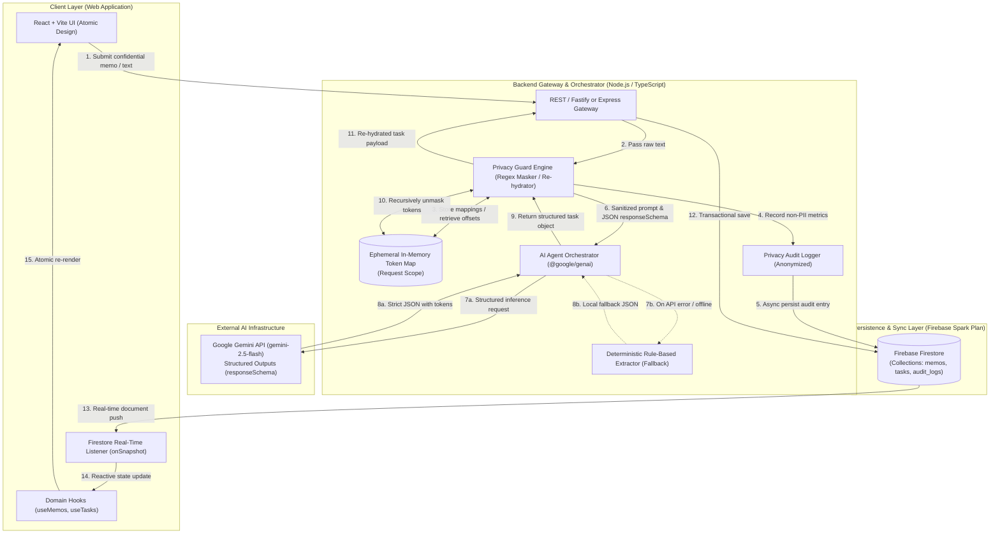
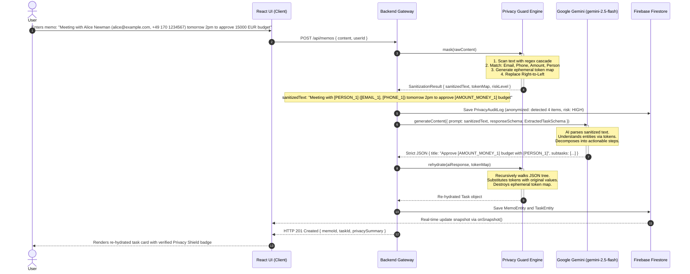
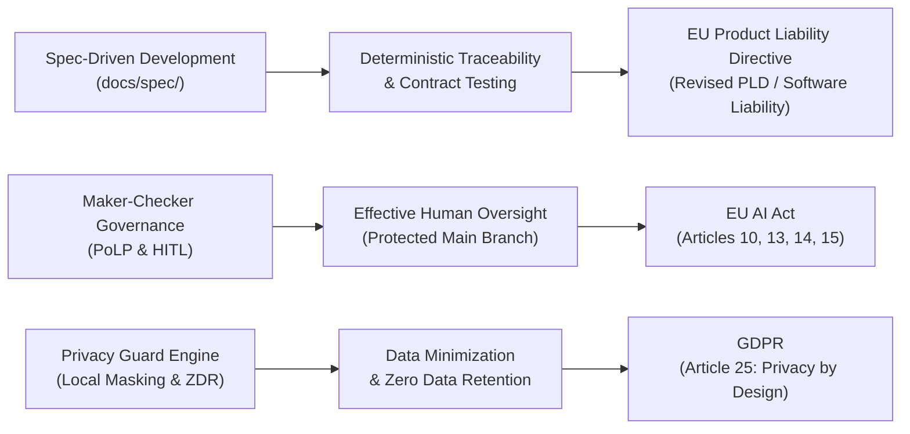

# OSCAR System Architecture Specification

## 1. Executive Summary & Vision
**OSCAR** (**O**rchestrated **S**ecure **C**onfidential **A**gent **R**untime) is an enterprise-grade, privacy-first personal assistant and task orchestration framework. It marries the analytical and generative capabilities of Google Gemini with rigorous data confidentiality guarantees based on Zero Data Retention (ZDR) and local Personally Identifiable Information (PII) masking.

The foundational principle of OSCAR is **Confidentiality by Design**: no sensitive user data—such as personal names, email addresses, monetary amounts, phone numbers, international bank account numbers (IBANs), or confidential tokens/keys—ever leaves the private, trusted execution boundary in plaintext.

---

## 2. High-Level System Architecture

OSCAR follows a multi-tiered, decoupled client-server architecture designed for high security, end-to-end type safety, and real-time synchronization.

---

## 3. Tiered Layer Specifications

### 3.1 Client Layer (Frontend)
* **Core Technology:** React 18+ with TypeScript, bundled using Vite.
* **Architecture Pattern:** **Atomic Design** system strictly structured to eliminate duplicated components and preserve maintainability:
  * `atoms/`: Smallest indivisible UI elements (e.g., `Button`, `Badge`, `Input`, `Icon`, `Typography`). Each component resides in its own dedicated subfolder with isolated CSS/Module styling (`src/components/atoms/Button/Button.tsx`, `Button.css`).
  * `molecules/`: Assemblies of atoms functioning as cohesive UI units (e.g., `PrivacyIndicator`, `PriorityBadge`, `SearchBar`, `DateDisplay`).
  * `organisms/`: Self-contained functional widgets bound to domain behavior (e.g., `MemoInputForm`, `TaskList`, `TaskCard`, `PrivacyAuditTable`).
  * `views/`: Page-level route targets (e.g., `DashboardView`, `TaskBoardView`, `SettingsView`).
* **Real-time Reactive Sync:** Client initializes direct Firestore subscriptions (`onSnapshot`) scoped to the active user context. When new tasks are created or status changes, UI reflects updates instantaneously without manual polling.
* **Security Posture:** Zero third-party API keys or service account credentials exist in the client bundle. All sensitive AI operations are routed through the backend gateway.

### 3.2 Backend Gateway & Orchestrator
* **Core Technology:** Node.js (v20+ LTS) running TypeScript with compiler configuration set to `strict: true`.
* **Primary Responsibilities:**
  1. **Confidentiality Guarding:** Intercepts every inbound prompt, extracts PII tokens using the Privacy Guard engine, and holds the replacement dictionary in request-scoped ephemeral memory.
  2. **AI Orchestration:** Communicates with the official `@google/genai` SDK using `generateContent` configured with `responseSchema` (structured outputs derived from Zod contracts).
  3. **Re-hydration & Sanitization:** Traverses the returned structured JSON hierarchy, substituting synthetic tokens with original values before persistence.
  4. **Auditability:** Writes anonymized performance and detection metrics (number of tokens masked, types detected, latency in ms) into the audit collection without logging any raw user PII.
  5. **Graceful Degradation:** Provides deterministic local regex extraction fallback if the external AI service returns 429 (rate limit), 503, or network timeout.

### 3.3 External AI Provider Layer (Google Gemini)
* **Model Selection:** `gemini-2.5-flash` (or current GA Flash model) optimized for low latency, high throughput, and cost-effectiveness under the Google AI Studio Free Tier (15 RPM / 1500 RPD).
* **Structured Outputs:** Gemini `generationConfig.responseSchema` is populated with a strict JSON schema generated directly from domain Zod definitions. This eliminates hallucinated formatting, markdown fencing drift, or missing required fields.
* **Zero Data Retention (ZDR):** Gemini API under standard enterprise terms operates with Zero Data Retention principles, preventing user prompts from being used to train general foundational models.

### 3.4 Persistence Layer (Firebase Firestore)
* **Hosting Model:** Cloud Firestore under Spark Tier (Free Plan: 1 GiB storage, 50,000 document reads, 20,000 document writes per day).
* **Data Model:**
  * `memos`: Represents the user's raw notes, metadata, creation timestamps, and privacy summary tags.
  * `tasks`: Contains actionable items, priorities, categorizations, deadlines, and decomposed subtask checklists.
  * `privacy_audit_logs`: Stores anonymized compliance logs tracking PII detections, risk levels, and processing latencies.
* **Real-time Engine:** Bi-directional document streaming over WebSockets/gRPC pushes database mutations immediately to listening clients.

---

## 4. End-to-End Data Flow Sequence

The complete lifecycle of a user prompt—from raw input to masked AI analysis, unmasking, database write, and real-time reactive rendering—is depicted below:

---

## 5. Zero Trust & Data Confidentiality Model

OSCAR is engineered from the ground up on Zero Trust principles:

1. **Client Isolation & Least Privilege:**
   * Browser clients never receive or store cloud provider credentials, Gemini API keys, or database administrative tokens.
   * Communication between client and gateway is secured via standard authenticated sessions.

2. **Ephemeral Memory Scope for PII:**
   * The `TokenMap` mapping synthetic placeholders (e.g., `[EMAIL_1]`) to cleartext values resides solely within volatile Node.js server memory during the lifespan of that specific HTTP request.
   * `TokenMap` objects are strictly excluded from server loggers, crash reports, disk caches, and permanent storage.

3. **Dual-Layer Schema Guardrails:**
   * **Inbound (AI Provider):** Google Gemini `responseSchema` forces the model to emit deterministic JSON structures compliant with domain types.
   * **Outbound (Application Gateway):** Returned payloads are verified at runtime using **Zod** schema validators before data ingestion. Malformed responses trigger automated retries or fallback extractors.

4. **Prompt Injection & Adversarial Safeguards:**
   * Inbound text is treated as untrusted data.
   * Prompts are wrapped in structured XML/Markdown demarcation boundaries, preventing user input from overriding system directives or leaking system prompts.

5. **Deterministic Graceful Degradation:**
   * If external AI providers experience outages, network partition, or quota exhaustion (HTTP 429), the gateway falls back to an internal rule-based regex and keyword extractor (`DeterministicFallbackExtractor`).
   * The user experience remains uninterrupted, and no task creation request is permanently lost.

---

## 6. Enterprise Auditability, Traceability & Regulatory Alignment

OSCAR is engineered to meet rigorous international standards for software integrity, deterministic traceability, and automated AI governance. By replacing undocumented, ad-hoc prompt coding with **Spec-Driven Development (SDD)**, **Contract-First Runtime Assurance**, and a **Maker-Checker Multi-Agent Architecture**, the platform establishes a verifiable, enterprise-grade engineering paradigm aligned with European Union regulatory frameworks.

### 6.1 High-Maturity Autonomous AI Engineering

| Maturity Level | Engineering Standard | OSCAR Operational Implementation |
| :--- | :--- | :--- |
| **Level 4: Quantitatively Managed** | System behavior is bounded, predictable, and validated through quantitative metrics and structural schemas. | • **Contract-First Engineering:** No implementation is introduced without pre-defined Zod schemas (`contracts.md`) and authoritative interface specifications. • **Dual-Layer Schema Assurance:** AI outputs are constrained at inference time via OpenAPI-compliant JSON Schemas (`responseSchema`) and re-validated at runtime on the gateway. • **Automated Quality Thresholds:** Vitest suites mandate $\ge 95\%$ line, branch, and function coverage with deterministic test isolation. |
| **Level 5: Optimizing Governance** | Continuous self-verification, independent quality auditing, and self-enforcing constitutional constraints. | • **Maker-Checker Topology:** Structural separation of concerns between implementation subagents (Makers) and independent auditing agents (Checkers). • **Constitutional Guardrails & Anti-Sycophancy:** Autonomous agents possess an explicit architectural mandate to reject non-compliant directives or specification violations. • **Automated Circuit Breakers:** Critique and review loops are capped at 2 iterations before mandatory human escalation, preventing unbounded conversational drift. |

### 6.2 Contract-First Runtime Assurance & Deterministic Traceability

In enterprise environments, every system state transition and AI-assisted data transformation must be deterministic, reproducible, and verifiable:
1. **Contract-First Runtime Assurance:** Every payload crossing process or architectural boundaries (client-gateway HTTP requests, external AI prompts, Firestore documents, and inter-agent messages) is validated against typed Zod schemas (`validateContract`). Schema drift and type corruption are caught and handled deterministically at runtime.
2. **Elimination of Ad-Hoc Prompt Coding:** Prompts are not composed of arbitrary or unversioned natural language fragments. All prompts utilize structured, tokenized templates combined with strict JSON schema definitions, guaranteeing reproducible outputs.
3. **Zero-PII Compliance Telemetry:** The `privacy_audit_logs` datastore records tamper-evident verification telemetry (cryptographic timestamps, detected entity types, risk assessments, and execution latency) while strictly excluding cleartext personal data from persistence.
4. **Deterministic Roundtrip Invariance:** The Privacy Guard engine enforces mathematical symmetry between sanitization and re-hydration ($\text{rehydrate}(\text{mask}(x)) \equiv x$), validated by isolated in-memory unit tests.

### 6.3 Regulatory Alignment & Legal Defect Containment

#### A. EU AI Act Compliance (Regulation (EU) 2024/1689)
OSCAR's architecture directly incorporates the compliance safeguards mandated for trustworthy AI systems:
* **Human Oversight (Article 14):** Ensured via strict **Human-in-the-Loop (HITL)** subagent instantiation protocols and **Protected Main Branch Governance** (autonomous agents operate exclusively on task branches; merge execution is reserved solely for the human Supervisor).
* **Technical Robustness & Cybersecurity (Article 15):** Dual-layer schema validation prevents malformed output injection; prompt demarcation boundaries guard against prompt injection vulnerabilities; in-memory isolation protects against data contamination.
* **Transparency & Traceability (Article 13):** Every inference request corresponds to documented domain schemas, and deterministic fallback pathways (`DeterministicFallbackExtractor`) ensure transparent, explainable behavior during upstream provider anomalies.
* **Data Governance & Minimization (Article 10):** Sensitive data is sanitized locally prior to external transmission, enforcing Zero Data Retention (ZDR) and data minimization across third-party cloud boundaries.

#### B. EU Product Liability Directive (Revised PLD)
The revised EU Product Liability Directive establishes strict liability for software and AI components, holding manufacturers liable for damages caused by defective or unverified code generation:
* **Defect Prevention over Ad-Hoc Generation:** Autonomous agents generate code strictly within pre-authorized specifications and contracts, systematically eliminating undocumented side-effects and hallucinations.
* **Exculpatory Evidence Trail:** By establishing an immutable Git history where specifications precede code, test suites prove $\ge 95\%$ coverage, and human approvals are recorded at every merge, the system provides conclusive proof that software conformed to the state-of-the-art and was defect-free at deployment.
* **Strict Fault Containment:** The Principle of Least Privilege (PoLP) confines subagents to isolated directory boundaries and toolsets, guaranteeing that any logic fault is quarantined within the subagent's sandbox and cannot compromise the core repository or production branch.

