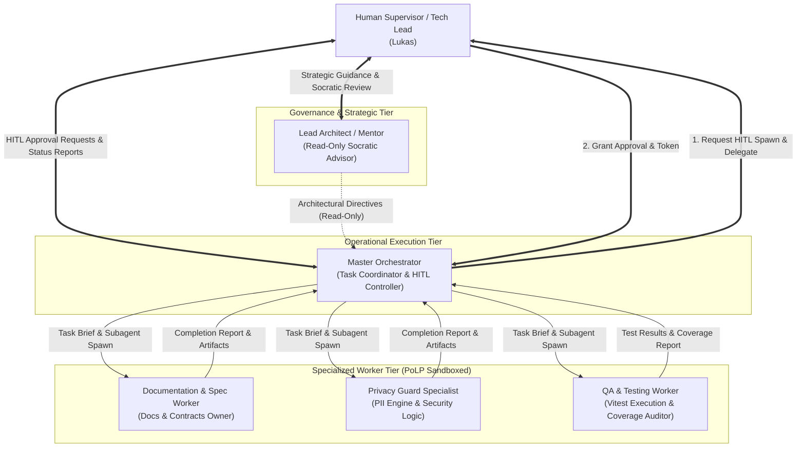

# OSCAR Multi-Agent System & Governance Specification

## 1. Executive Summary & Purpose
The development and operation of **OSCAR** is structured around an autonomous, role-segregated **Multi-Agent System (MAS)** governed by two inviolable principles:
1. **Principle of Least Privilege (PoLP):** Every agent and subagent operates with strictly scoped tool permissions, directory boundaries, and read/write authorizations. No agent is granted blanket administrative or universal write access.
2. **Human-in-the-Loop (HITL):** High-impact actions—including subagent instantiation, external network calls, schema modifications, database writes, and Git commits—require explicit authorization by the human supervisor (**Lukas**).

This model prevents uncontrolled autonomous drift ("vibe coding"), guarantees reproducibility, and ensures total auditability across the software lifecycle.

---

## 2. Agent Workforce Architecture & Topology



---

## 3. Agent Roles & Privilege Matrix (PoLP)

| Role | Operational Scope & Mandate | Allowed File Boundaries | Tool Authorizations | Prohibited Actions |
| :--- | :--- | :--- | :--- | :--- |
| **Lead Architect / Mentor** | Strategic architecture, requirements verification, Socratic dialogue with Lukas. Operates outside active code execution. | Read access across entire workspace. **Zero write access.** | `view_file`, `search_docs`, `read_resource`. | **Strictly forbidden from writing any files**, running shell commands, or spawning subagents. |
| **Master Orchestrator** | High-level execution manager. Breaks down epics into atomic tasks, formulates subagent briefs, and coordinates workflows. | `oscar/` root for task tracking; coordinates other agents. | `send_message`, `manage_task`, `view_file`, `schedule`. | Cannot run broad file edits or install dependencies without explicit HITL approval from Lukas. |
| **Documentation & Spec Worker** | Authoritative owner of Spec-Driven Development (SDD), architecture documents, Zod schemas, and repo metadata. | `oscar/docs/`, `oscar/.gitignore`, `oscar/README.md`. | `view_file`, `write_file`, `edit_file`, `send_message`. | **Cannot edit any application source code** (`server/src/`, `client/src/`), cannot execute shell servers or network requests. |
| **Privacy Guard Specialist** | Cryptographic & algorithmic specialist. Implements deterministic regex tokenization, RTL substitution, and re-hydration. | `oscar/server/src/privacy/`, `oscar/server/tests/privacy/`. | `view_file`, `write_file`, `edit_file`, `run_command` (scoped to `vitest run`). | Cannot modify frontend components or external API routes. |
| **QA & Testing Worker** | Test automation and coverage verification. Validates contracts, runs test suites, monitors regression, and checks thresholds. | `oscar/server/tests/`, `oscar/client/tests/`, test configs. | `view_file`, `write_file`, `run_command` (testing commands only). | Cannot modify production logic or deployment credentials. |

---

## 4. Human-in-the-Loop (HITL) Protocols

### 4.1 Subagent Instantiation Workflow
Before any specialized subagent is spawned, the Master Orchestrator must submit a formal declaration to Lukas containing:
1. **Target Subagent Role:** Name and specific responsibility.
2. **Justification:** Exact engineering task requiring isolation.
3. **PoLP Boundary:** Explicit list of allowed directories, files, and tools.
4. **Acceptance Criteria:** Deterministic definition of "done".

Execution begins only after Lukas responds with explicit confirmation (e.g., *"Approved: proceed with Docs Worker"*).

### 4.2 Code Review & Mutation Checkpoints
* All files generated or updated by subagents are summarized in a structured completion report delivered back to the Orchestrator and Lukas.
* No Git commits or branch merges occur automatically. Commits are verified and staged by human decision.

### 4.3 Incident Escalation & Circuit Breaker
If an agent encounters any of the following conditions, it must halt execution immediately and escalate to the Master Orchestrator and Lukas:
* Access denied or permission boundary violation.
* Schema conflict between AI output and Zod validation.
* Unit test coverage dropping below 95% on core privacy modules.
* External API failure or unrecoverable rate limiting.

---

## 5. Inter-Agent Communication Protocol

Subagents communicate via asynchronous, structured messages passing through the system bus. Every message between agents adheres to the following contract:

```typescript
export interface AgentMessage {
  messageId: string;
  senderId: string;
  recipientId: string;
  timestamp: string; // ISO 8601
  messageType: 'TASK_BRIEF' | 'STATUS_UPDATE' | 'HITL_REQUEST' | 'COMPLETION_REPORT' | 'ESCALATION';
  payload: {
    taskSummary: string;
    affectedPaths: string[];
    details: Record<string, unknown>;
  };
}
```

### Protocol Invariants:
1. **Single-Responsibility Turns:** An agent finishes its assigned brief and delivers a complete final report via `send_message` rather than engaging in unbounded conversational loops.
2. **Zero Ambient State:** All critical task parameters, schema requirements, and file paths must be explicitly passed in the prompt or message body.
3. **Artifact Referencing:** Large artifacts (e.g., full test outputs or architectural diffs) are saved to designated specification or test files, with absolute paths passed in the payload.
