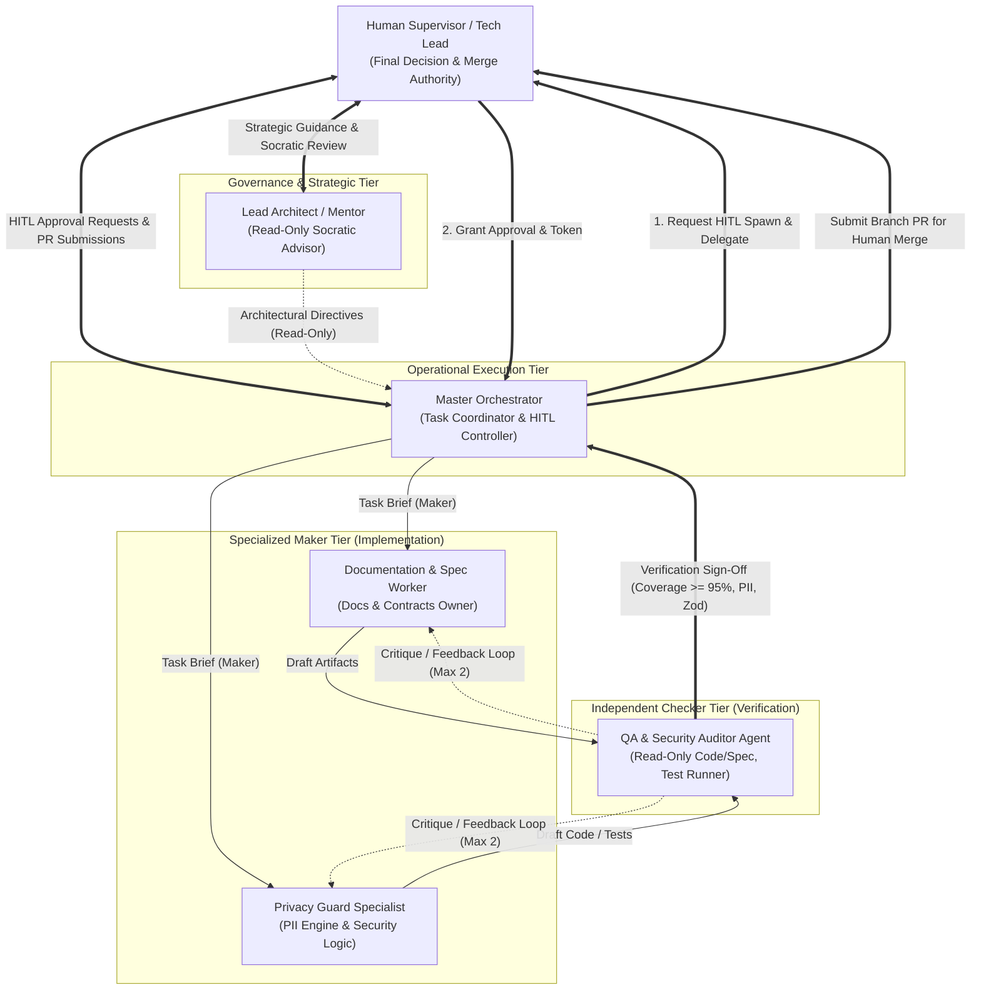

# OSCAR Multi-Agent System & Governance Specification

## 1. Executive Summary & Purpose
The development and operation of **OSCAR** is structured around an autonomous, role-segregated **Multi-Agent System (MAS)** governed by three inviolable principles:
1. **Principle of Least Privilege (PoLP):** Every agent and subagent operates with strictly scoped tool permissions, directory boundaries, and read/write authorizations. No agent is granted blanket administrative or universal write access.
2. **Human-in-the-Loop (HITL):** High-impact actions—including subagent instantiation, external network calls, schema modifications, database writes, and Git commits—require explicit authorization by the human **Supervisor**.
3. **Strict Branch Protection & Human Merge Governance:** Agents and subagents are **strictly prohibited** from merging into the `main` branch. The `main` branch is permanently protected. Agents operate exclusively on isolated task/feature branches. All Pull Requests (PRs) must be reviewed, approved, and merged exclusively by the human **Supervisor**.

This model prevents uncontrolled autonomous drift ("vibe coding"), guarantees reproducibility, and ensures total auditability across the software lifecycle.

---

## 2. Agent Workforce Architecture & Topology

OSCAR employs a **Maker-Checker Architecture** to enforce separation of concerns between code generation and independent quality/security verification.



---

## 3. Agent Roles & Privilege Matrix (PoLP)

| Role | Operational Scope & Mandate | Allowed File Boundaries | Tool Authorizations | Prohibited Actions |
| :--- | :--- | :--- | :--- | :--- |
| **Lead Architect / Mentor** | Strategic architecture, requirements verification, Socratic dialogue with the Supervisor. Operates outside active code execution. | Read access across entire workspace. **Zero write access.** | `view_file`, `search_docs`, `read_resource`. | **Strictly forbidden from writing any files**, running shell commands, or spawning subagents. |
| **Master Orchestrator** | High-level execution manager. Breaks down epics into atomic tasks, formulates subagent briefs, coordinates workflows, and prepares PR summaries. | `oscar/` root for task tracking; coordinates other agents. | `send_message`, `manage_task`, `view_file`, `schedule`, `run_command` (scoped). | Cannot merge to `main`, install unsanctioned packages, or spawn subagents without explicit HITL approval from the Supervisor. |
| **Documentation & Spec Worker** | Authoritative owner of Spec-Driven Development (SDD), architecture documents, Zod schemas, and repo metadata. | `oscar/docs/`, `oscar/.gitignore`, `oscar/README.md`. | `view_file`, `write_file`, `edit_file`, `send_message`. | **Cannot edit any application source code** (`server/src/`, `client/src/`), cannot execute shell servers or network requests. |
| **Privacy Guard Specialist** | Cryptographic & algorithmic specialist. Implements deterministic regex tokenization, RTL substitution, and re-hydration. | `oscar/server/src/privacy/`, `oscar/server/tests/privacy/`. | `view_file`, `write_file`, `edit_file`, `run_command` (scoped to `vitest run`). | Cannot modify frontend components, external API routes, or merge branches. |
| **QA & Security Auditor Agent** | Independent **Checker** role. Evaluates Maker deliverables against specs, executes test suites, audits PII leaks, and validates Zod schemas. | **Read-Only** access to code & spec. Scoped test runner. | `view_file`, `run_command` (`vitest run`, `vitest run --coverage`), `send_message`. | **Strictly forbidden from editing source code or specifications**. Cannot approve PRs or merge to `main`. |

---

## 4. Maker-Checker Architecture & Review Loops

To guarantee zero regressions and eliminate hallucinated implementations, all code and specification modifications must pass an independent **Maker-Checker validation loop**:

1. **Maker Turn:** The designated Maker agent (e.g., Privacy Guard Specialist or Docs Worker) implements the task strictly within its assigned boundaries.
2. **Checker Audit:** The **QA & Security Auditor Agent** is invoked with Read-Only permissions to code/specs and scoped command execution for tests:
   - **Test Execution & Coverage:** Verifies that Vitest passes with $\ge 95\%$ line, branch, and function coverage on domain modules.
   - **PII Leak Auditing:** Asserts that cleartext sensitive data never escapes into logs, schemas, or prompt templates.
   - **Zod Contract Adherence:** Validates that runtime objects strictly conform to defined contracts (`contracts.md`).
3. **Critique & Convergence Limit:**
   - If flaws or gaps are detected, the Auditor generates a structured critique message detailing failing assertions.
   - The Maker resolves the issues and resubmits to the Auditor.
   - **Circuit Breaker:** A maximum of **2 critique loops** is permitted. If consensus is not reached within 2 iterations, the workflow halts and immediately escalates to the human Supervisor for resolution.
4. **Sign-off:** Upon satisfactory audit, the Auditor issues a typed `COMPLETION_REPORT` to the Master Orchestrator.

---

## 5. Human-in-the-Loop (HITL) & Branch Governance

### 5.1 Subagent Instantiation Workflow
Before any specialized subagent is spawned, the Master Orchestrator must submit a formal declaration to the Supervisor containing:
1. **Target Subagent Role:** Name and specific responsibility.
2. **Justification:** Exact engineering task requiring isolation.
3. **PoLP Boundary:** Explicit list of allowed directories, files, and tools.
4. **Acceptance Criteria:** Deterministic definition of "done".

Execution begins only after the Supervisor responds with explicit confirmation (e.g., *"Approved: proceed with Docs Worker"*).

### 5.2 Strict Branch Protection & Merge Authority
* **Branch Policy:** The `main` branch is protected and immutable to agent automation. All agentic development occurs on explicit task branches (e.g., `docs/spec-initial-architecture`).
* **Zero Autonomous Merges:** No agent has permissions to execute `git merge main`, `git checkout main`, or push to `main`.
* **Human Handover:** When a feature branch passes all Auditor checks, the Master Orchestrator pushes the branch and presents a structured Pull Request summary to the Supervisor. The Supervisor alone reviews, approves, and merges the PR on GitHub.

### 5.3 Incident Escalation & Circuit Breaker
If an agent encounters any of the following conditions, it must halt execution immediately and escalate to the Master Orchestrator and the Supervisor:
* Access denied or permission boundary violation.
* Schema conflict between AI output and Zod validation.
* Unit test coverage dropping below 95% on core privacy modules.
* Critique loop limit (2 iterations) exceeded without convergence.
* External API failure or unrecoverable rate limiting.

---

## 6. Inter-Agent Communication Protocol

Subagents communicate via asynchronous, structured messages passing through the system bus. Every message between agents adheres to the following contract:

```typescript
export interface AgentMessage {
  messageId: string;
  senderId: string;
  recipientId: string;
  timestamp: string; // ISO 8601
  messageType: 'TASK_BRIEF' | 'STATUS_UPDATE' | 'HITL_REQUEST' | 'CRITIQUE' | 'COMPLETION_REPORT' | 'ESCALATION';
  payload: {
    taskSummary: string;
    affectedPaths: string[];
    details: Record<string, unknown>;
  };
}
```

### Protocol Invariants:
1. **Single-Responsibility Turns:** An agent finishes its assigned brief and delivers a complete final report via `send_message` rather than engaging in unbounded conversational loops.
2. **Zero Ambient State:** All critical task parameters, schema requirements, and file paths must be explicitly passed in the prompt or message body.
3. **Artifact Referencing:** Large artifacts (e.g., full test outputs or architectural diffs) are saved to designated specification or test files, with absolute paths passed in the payload.
