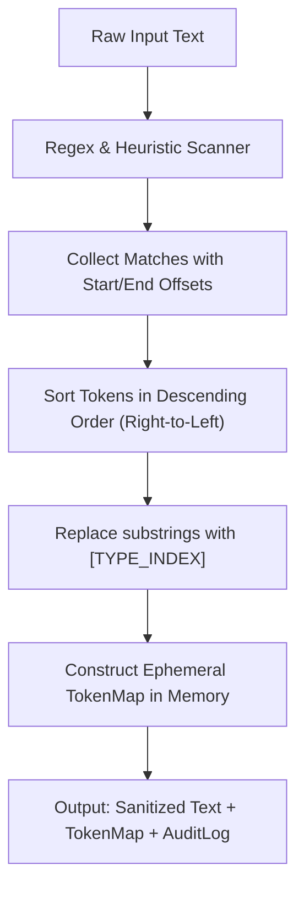

# OSCAR Privacy Guard Engine Specification

## 1. Purpose & Mandate
The **Privacy Guard Engine** is the foundational security boundary of OSCAR. It ensures that sensitive personal identifiable information (PII) and confidential credentials never leave the host environment when interacting with external AI providers.

---

## 2. Detection Rules & Heuristics

The engine executes a cascade of deterministic regular expressions and heuristic tokenizers in priority order:

| Priority | PII Category | Detection Logic / Regex Pattern | Example Match | Replacement Token |
| :--- | :--- | :--- | :--- | :--- |
| **1** | **API / Secret Key** | `(?i)(bearer\s+[a-z0-9_\-\.]{20,}\|ghp_[a-z0-9]{36}\|ai[a-z0-9_\-]{30,})` | `ghp_123456...` | `[SECRET_KEY_1]` |
| **2** | **Email Address** | `[a-zA-Z0-9._%+-]+@[a-zA-Z0-9.-]+\.[a-zA-Z]{2,}` | `frank@pta.de` | `[EMAIL_1]` |
| **3** | **Phone Number** | `(\+?[0-9]{1,3}[-.\s]?)?(\(?\d{2,4}\)?[-.\s]?)?\d{3,4}[-.\s]?\d{3,4}` | `+49 170 1234567` | `[PHONE_1]` |
| **4** | **Monetary Amount** | `(\$|€|£|PLN|EUR|USD)\s?(\d{1,3}(?:[.,\s]\d{3})*(?:[.,]\d{1,2})?)` or `(\d{1,3}(?:[.,\s]\d{3})*(?:[.,]\d{1,2})?)\s?(€|\$|£|PLN|EUR|USD)` | `15000 EUR`, `$450.00` | `[AMOUNT_MONEY_1]` |
| **5** | **IBAN** | `[A-Z]{2}\d{2}[A-Z0-9]{11,30}` | `DE8937040044...` | `[IBAN_1]` |
| **6** | **Person / Name** | Capitalized two-word sequence matching context clues (e.g. `with Frank Dietrich`, `meeting Mr. Smith`) | `Frank Dietrich` | `[PERSON_1]` |

---

## 3. Masking Algorithm (Step-by-Step)



### Engineering Details:
1. **Right-to-Left Replacement:** Matches are sorted by `startIndex` descending before string substitution. This ensures that replacing an offset later in the string does not invalidate earlier offsets.
2. **Ephemeral Memory Scope:** The translation map (`TokenMap`) exists only in the server request context and is discarded immediately after unmasking.
3. **Escaping & Safety:** All token strings follow strict bracketed notation `[CATEGORY_N]` that will not collide with standard natural language punctuation.

---

## 4. Unmasking Algorithm (Re-hydration)

Once Google Gemini returns the structured JSON response, the Privacy Guard traverses the JSON structure recursively:

```typescript
function rehydrate<T>(target: T, tokenMap: Map<string, string>): T {
  if (typeof target === 'string') {
    let result = target;
    for (const [token, original] of tokenMap.entries()) {
      result = result.replaceAll(token, original);
    }
    return result as unknown as T;
  }
  if (Array.isArray(target)) {
    return target.map(item => rehydrate(item, tokenMap)) as unknown as T;
  }
  if (target !== null && typeof target === 'object') {
    const output: Record<string, unknown> = {};
    for (const [key, val] of Object.entries(target)) {
      output[key] = rehydrate(val, tokenMap);
    }
    return output as unknown as T;
  }
  return target;
}
```

---

## 5. Test Suite & Acceptance Criteria (Target: >= 95% Coverage)

The unit test suite in `tests/privacy/PrivacyGuard.spec.ts` must assert:
1. **Multi-token replacement:** A sentence containing email, phone, and money is replaced without overlap issues.
2. **Identical repetition:** Two occurrences of the same email receive the same token (`[EMAIL_1]`) or consistent mapping.
3. **Punctuation boundaries:** Trailing dots and commas are not swallowed into emails or money amounts.
4. **Idempotency & Reversibility:** `unmask(mask(text).sanitizedText, tokenMap) === rawText`.
5. **No Network Calls:** The test suite runs 100% in-memory with zero I/O dependency, executing in < 50ms.
